 

## 👋 Sobre mí

- ⚙️ Ingeniero Industrial en **3PL**, llevando tecnología a la logística.
- 🐍 Python, automatización y datos: dashboards, pronósticos y analítica.
- 🤖 Homelab con LLMs locales y agentes de IA.
- 🛡️ Ciberseguridad aplicada: rescate de datos de un NAS atacado por ransomware.
- 🚀 Construyendo **[Gradient AI](https://www.gradientai.lat/)**: CRM con WhatsApp, agentes y automatización para negocios.

## 🛠️ Tecnologías

  

## 🐍 Mi actividad

  <picture>
    <source media="(prefers-color-scheme: dark)" srcset="https://raw.githubusercontent.com/samuelgradientai-sys/samuelgradientai-sys/output/github-snake-dark.svg">
    <source media="(prefers-color-scheme: light)" srcset="https://raw.githubusercontent.com/samuelgradientai-sys/samuelgradientai-sys/output/github-snake.svg">
    
  </picture>

